# Sony BRAVIA XR-65X90K — 國行刷官方港版固件紀錄（ADB 槽位寫入法）

English: these notes document one mainland-China Sony BRAVIA **XR-65X90K** flashed to the official Hong Kong firmware using `adb` and Sony's own updater, so the set runs Google TV. The core method — push Sony's signed package to the set, invoke the set's own manual update service so `update_engine` writes the **inactive A/B slot**, then switch slots — comes from a Chiphell post about an A90J (see Acknowledgements). This record extends that method to the XR-65X90K, including a **cross-version** write (CN 6.8162 → HK 6.8246) and the black-screen recovery that followed it. In principle the same route applies to **any model that meets the prerequisites listed under 適用範圍**; the XR-65X90K is simply the fully documented case here. Every step below was executed with a verification checkpoint before moving on; the checkpoints are written out in full because they are what made the difference between a controlled write and a blind one. This repository does not contain firmware. Sony firmware remains Sony's. The MIT license covers these notes and the helper script only.

**風險（先讀）。** 寫入固件可以令電視黑屏、清除所有應用與帳戶，嚴重時整機無法使用，要付費送修。本次刷寫就真實經歷了約四小時黑屏，一度已致電 Sony 報修。寫入期間必須全程維持插電，不可熄屏休眠，不可拔電。跨區刷寫會令保養失效。其他型號的套件不可用在本型號；版本號相同也不代表套件通用。本文是一台 XR-65X90K 的完整實測紀錄；方法理論上適用於其他符合前提的型號（見「適用範圍」），但未驗證型號的風險更高。這不是 Sony 支援的升級路徑。

## 致謝

本方法源自 Chiphell 論壇帖子 [2915377](https://www.chiphell.com/thread-2915377-1-1.html)：樓主在國行 **XR-83A90J** 上首創並公開了這條路線——用 ADB 把官方簽名套件推入電視，呼叫電視內置的手動更新服務（`NddManualAgentService`）把套件寫入備用槽，再切槽重啟，從而繞過 USB 更新的地區檢查。沒有他把服務名稱、intent 參數（包括 Sony 原廠拼錯的 `SEAECH_TYPE`）和切槽方法逐一挖出來並公開，本文的刷寫不可能發生。本文沿用他的方法，只把適用型號換成 XR-65X90K，並補上他帖中沒有的 X90K 實測、跨版本結果與黑屏恢復紀錄。帖中其他型號的套件與校驗值不適用於本型號，請勿混用。

全程由 AI 助手逐步引導：每一步先講明預期結果，執行後以截圖、指令輸出或日誌核對，核對通過才進行下一步。下文「逐步驗證流程」即按該次序記錄。

## 本案例的特點

- **首個公開的 XR-65X90K（VH21 平台）紀錄。** 原帖 7 頁回覆中從未出現 X90K 或 VH21；本案例證明同一方法在 VH21 上同樣成立。
- **跨版本成功。** 原帖有版本紀錄的成功案例全部是同版本對刷（國行 6.8246 → 港版 6.8246）。本案例由國行 **PKG6.8162** 直接寫入港版 **6.8246**，同樣成功。保守起見，同版本對刷仍然是風險最低的路線；跨版本可行是本案例的新增實證（單一樣本，不保證每台必成）。
- **不拆機、不換主板。** 全程只用 Sony 官方簽名套件與電視內置的官方更新服務，不改簽名、不解鎖、不動硬件。過往國行改海外版要換主板，現在軟件層面即可完成。
- **每一步可驗證。** 套件在電腦端與電視端做 SHA-256 雙向比對；寫入以 `logcat` 的完成回調（`errorCode=0`）為準，不靠估計時間；完成後以 build fingerprint 核實運行的是港版系統。
- **黑屏恢復的實測條件。** 本案例確認：機身按鍵強制恢復在本機多次嘗試無反應，**拔電約兩小時、待機電源完全放電後再試，白色 LED 首次亮起、恢復才真正觸發**；觸發後還需要多一至兩個開機循環才進入設定畫面。這一段是原帖沒有的經驗。
- **港版與國行同為 DTMB 制式**，刷後地面波電視功能保留。

## 適用範圍：理論上符合前提的型號都可以刷

本方法不是 X90K 專屬。原理上，任何**同時**符合以下前提的 Sony Android TV，都可以用同一條路線刷入目標地區的官方固件：

1. **A/B 雙槽分區**：`getprop ro.boot.slot_suffix` 有值（`_a` 或 `_b`）。沒有 A/B 分區的型號不適用——原帖中 8500F 正是因為沒有 A/B 分區而失敗。
2. **目標地區官方套件列明適用於該型號**：到目標地區的 Sony 支援頁核對適用型號清單，不要靠版本號估計。
3. **防回滾序號不低於現有固件**：目標套件的防回滾序號（內層檔名尾段）必須 ≥ 現有固件的序號；同底版本對刷最穩陣（本案例的跨版本是序號更高的一次實證）。
4. **系統內有手動更新服務**：`pm path com.sony.dtv.systemupdate` 查得到，且包含 `NddManualAgentService`。
5. **調諧制式相容**：原地區與目標地區的電視制式相同（例：國行 DTMB ↔ 港版 DTMB）；不要刷去制式不同的地區（例：美版 ATSC）。
6. **ADB 可連接、空間足夠**：電視可開啟 ADB 調試，剩餘空間大於套件大小。

已驗證的型號：原帖的 A90J、A80J、X90L、X9000H、9500G 等，加上本案例的 XR-65X90K。要講清楚：**已驗證的只有這些**。其他型號即使前提全中，第一次試仍屬未驗證操作，黑屏與送修的風險自負；落手前請逐項核對上面六點，並先想好恢復與送修的預案。下文的版本事實、檔名與校驗值全部是 X90K 專屬，其他型號請換回自己型號的官方套件與數值。

## 版本事實（2026-11-22 實測）

- 機型：XR-65X90K，平台 BRAVIA 4K VH21。
- 刷前：國行 **PKG6.8162.0961CNA**，fingerprint `Sony/BRAVIA_VH21_M_CN/BRAVIA_VH21:12/STT2.230505.001.S102/681621:user/release-keys`，運行槽 `_b`。
- 目標套件：Sony 香港官方頁的 **PKG6.8246 HKA**（發行日期 2026-11-04），XR-65X90K 在其適用型號清單內；港版頁面要求現版本 ≥ 6.3770，本機 6.8162 滿足。
  - 官方頁：[XR-65X90K 支援](https://www.sony.com.hk/zh/electronics/support/televisions-projectors-lcd-tvs-android-/xr-65x90k) ／ [驅動程式及軟體更新](https://www.sony.com.hk/zh/electronics/support/televisions-projectors-lcd-tvs-android-/xr-65x90k/downloads)
  - 外層檔案：`sony_atvotafull_2020_1608246100_hka_auth.zip`，1,872,195,905 bytes。
  - 內層 ZIP：`sony_dtv0FA80A0CA0AC_00004B00_16082461000977.zip`，1,871,849,016 bytes。
  - 內層 DEP：`sony_dtv0FA80A0CA0AC_00004B00_16082461000977_F08D.dep`，80 bytes。
  - 內層 ZIP 的 SHA-256（本次下載實測，作比對基準；自行下載後應先核對一致才使用）：`9b313cfd01c119f059ddf44cfb629c432c25357954a5e9cd042c5cab3985ade3`
- 關鍵對應關係：港版與國行 6.8246 套件同底（`1608246100`），防回滾序號同為 `16082461000977`——這是可寫入的前提。內層檔名中段是地區碼：國行 `00004600`／DEP 後綴 `_4D81`，港版 `00004B00`／`_F08D`；裝置段 `0FA80A0CA0AC` 與防回滾序號兩版一致。
- 套件請自行向 Sony 香港官方頁下載。本倉庫不附固件檔案。

## 事前準備

- 本紀錄以 XR-65X90K 為對象，套件來自上面 Sony 香港頁面且列給本型號；其他型號先逐項核對「適用範圍」的前提，並換用自己型號的官方套件。
- 電腦已安裝 `adb`（本次用 platform-tools 37.0.3）。電視已開啟開發者選項與 ADB 調試，並已允許這台電腦。
- 電腦與電視在同一個區域網。位址只放在你自己的 `TV_IP` 裡。本倉庫不記錄區域網位址、MAC、Wi-Fi 名稱、路由器或任何憑證。
- 在內地下載套件需要代理／VPN：Sony 海外更新主機的域名在內地 DNS 解析不到（本次實測下載時出現 `DNS_PROBE_FINISHED_NXDOMAIN`），開啟全域代理後才下載成功。
- 全程維持市電。寫入過程中不要拔電、不要關插座。
- 預計黑屏與恢復可能需時數小時，不要在趕時間的日子做。

## 逐步驗證流程

以下相片全部為本次刷寫的實拍；帳戶名、主機名、區域網位址、支援 QR code 與帳戶頭像等個人資料已打碼。

### 關卡 0 — 電腦端驗證套件
只解開外層 ZIP，**內層 ZIP 不要再解壓**。核對內層 ZIP 與 DEP 的檔名、大小與上表一致，並計算內層 ZIP 的 SHA-256，與上表基準值一致才繼續。檔名中段必須是港版地區碼 `00004B00`。

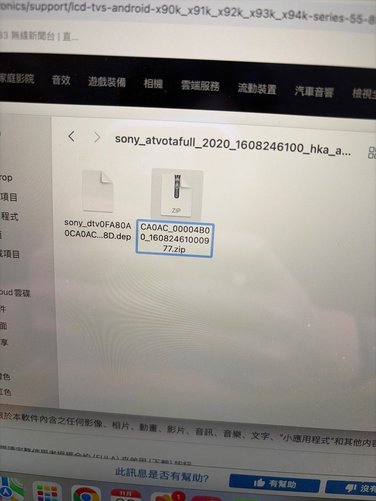
*關卡 0：解壓後應有內層 ZIP 與 DEP 兩個檔案，ZIP 檔名中段為港版地區碼 `00004B00`。*

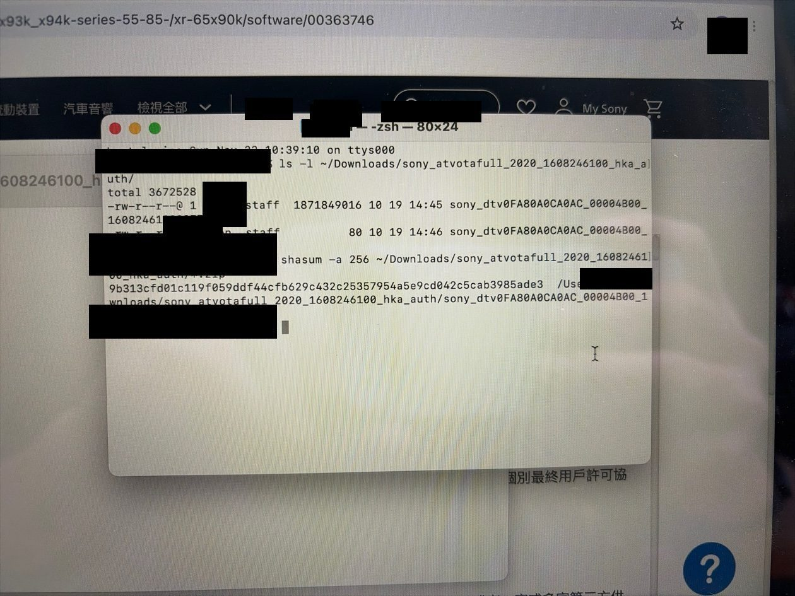
*關卡 0：本機核對大小（1,871,849,016 與 80 bytes）並計算 SHA-256，結果 `9b313cfd…ade3` 與基準值一致。*

### 關卡 1 — 電視端事前讀數
連接後先讀三項，確認目標正確、空間足夠：
```bash
adb connect "$SERIAL"            # SERIAL = TV_IP:5555
adb -s "$SERIAL" shell getprop ro.product.model          # 應為 BRAVIA 4K VH21
adb -s "$SERIAL" shell getprop ro.build.fingerprint      # 應為 M_CN / 681621
adb -s "$SERIAL" shell getprop ro.boot.slot_suffix       # 本次為 _b，即新固件將寫入槽 A
```
本次電視剩餘空間約 20 GB，遠高於套件的 1.87 GB。

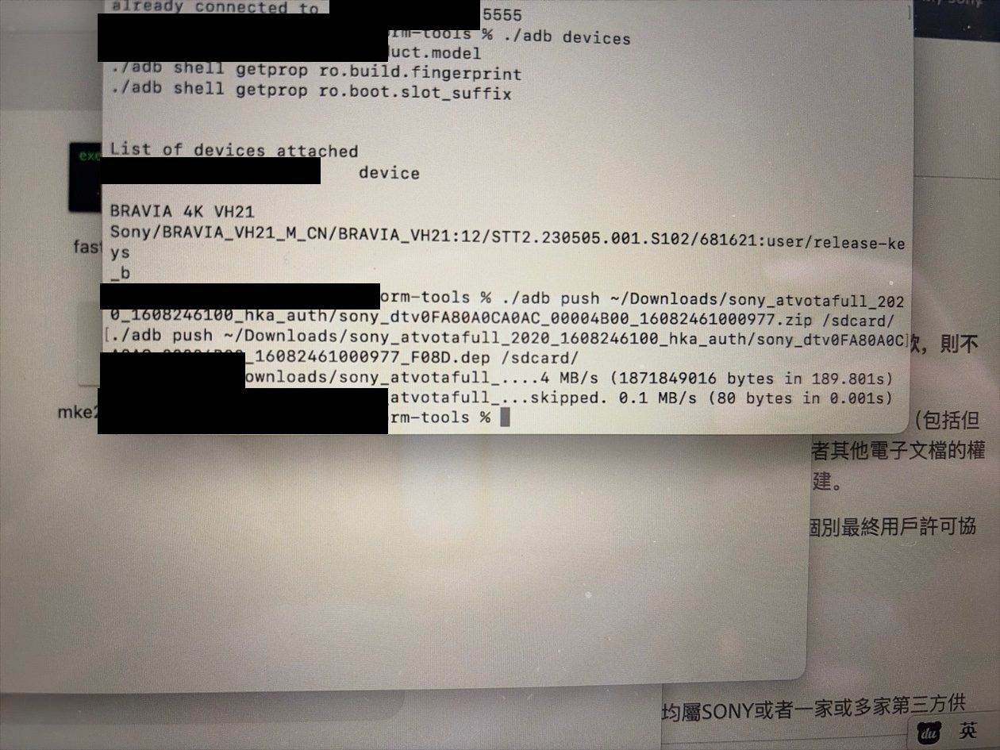
*關卡 1–2：讀數確認 VH21、國行 fingerprint（M_CN / 681621）、運行槽 `_b`；其後推送兩個檔案（1,871,849,016 bytes，約 190 秒）。*

### 關卡 2 — 推送並雙向比對 SHA-256
把內層 ZIP 與 DEP 兩個檔案推入電視，然後在電視端重算 SHA-256，**與電腦端逐字一致才可繼續**：
```bash
adb -s "$SERIAL" push sony_dtv0FA80A0CA0AC_00004B00_16082461000977.zip /sdcard/
adb -s "$SERIAL" push sony_dtv0FA80A0CA0AC_00004B00_16082461000977_F08D.dep /sdcard/
sha256sum sony_dtv0FA80A0CA0AC_00004B00_16082461000977.zip
adb -s "$SERIAL" shell sha256sum /sdcard/sony_dtv0FA80A0CA0AC_00004B00_16082461000977.zip
```

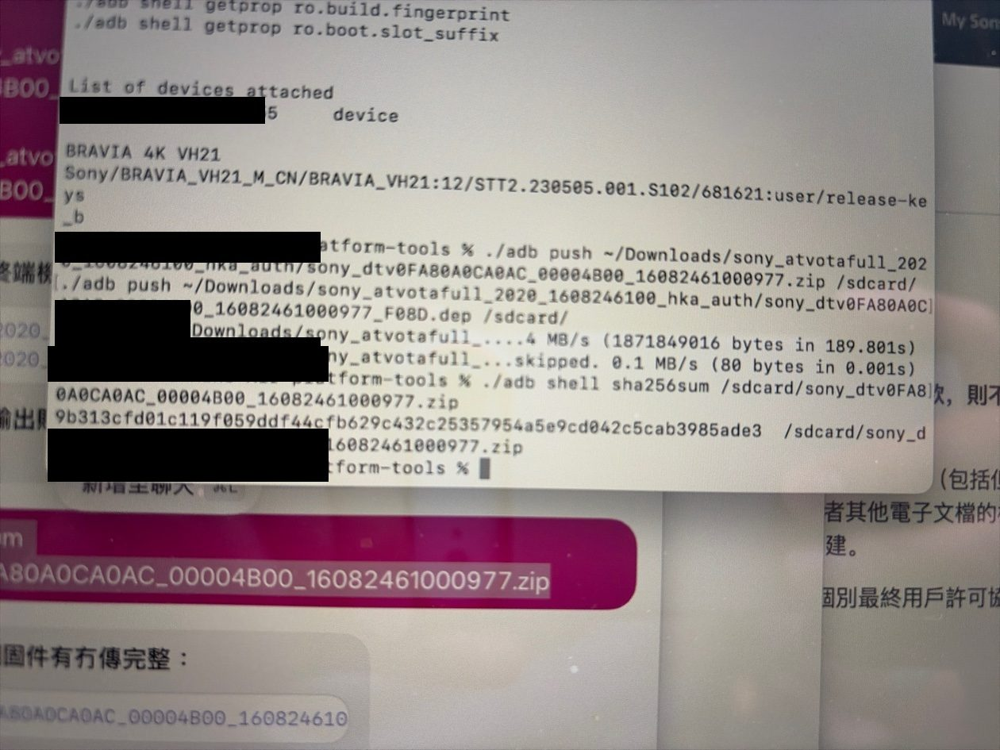
*關卡 2：電視端重算的 SHA-256 與電腦端逐字一致，傳輸無損，先至可以寫入。*

### 關卡 3 — 電視端準備
```bash
adb -s "$SERIAL" shell pm grant com.sony.dtv.systemupdate android.permission.READ_EXTERNAL_STORAGE
adb -s "$SERIAL" shell pm disable-user --user 0 com.sony.dtv.otaurlprovisioning
```
注意：對 `com.sony.dtv.otaurlprovisioning` 直接 `pm disable` 會被拒（特權應用，SecurityException），必須用 `pm disable-user --user 0`。

### 關卡 4 — 觸發寫入，並以日誌完成回調為準
先在另一個終端開 `logcat` 監察，再送出更新指令。intent extra 鍵的拼法是 **`SEAECH_TYPE`**——這是 Sony 原廠的拼法，不要「改正」成 `SEARCH`：
```bash
adb -s "$SERIAL" logcat | grep -iE "update_engine|NddManual|payload"

adb -s "$SERIAL" shell am start-foreground-service --user 0 \
  -n com.sony.dtv.systemupdate/com.sony.dtv.systemupdate.service.NddManualAgentService \
  -a com.sony.dtv.intent.action.START_UPDATE \
  --es com.sony.dtv.intent.extra.URL "file:///sdcard/sony_dtv0FA80A0CA0AC_00004B00_16082461000977.zip" \
  --ei com.sony.dtv.intent.extra.SEAECH_TYPE 0
```
本次寫入約 5 分鐘（2538 項操作）。**必須等到日誌出現以下兩行才算寫完**，不要憑時間猜測：
```
Update successfully applied, waiting to reboot.
onPayloadApplicationComplete(errorCode=0)
```

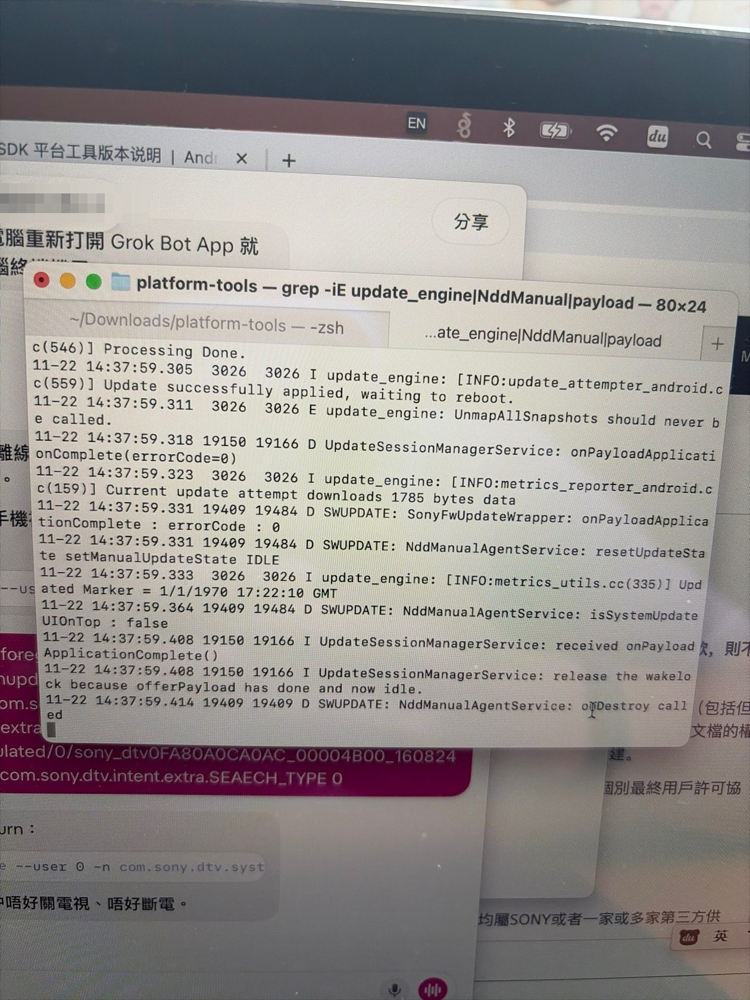
*關卡 4：`Update successfully applied, waiting to reboot.` 與 `onPayloadApplicationComplete(errorCode=0)` 出現，寫入完成並驗證無誤。*

### 關卡 5 — 切槽重啟
確認寫完後才送出：
```bash
adb -s "$SERIAL" shell am start \
  -n com.sony.dtv.systemupdate/com.sony.dtv.systemupdate.ui.activities.SwitchSlotActivity \
  -a com.sony.dtv.intent.action.SHOW_UPDATE_CONFIRMATION
```
電視隨即黑屏重啟，進入新槽。

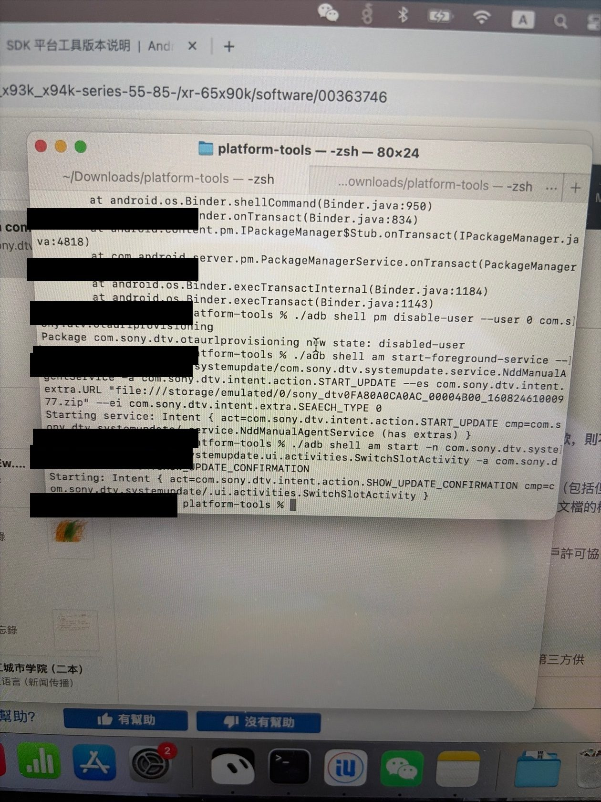
*關卡 3–5 實拍：`pm disable-user` 回應 `disabled-user`、`START_UPDATE` 服務啟動、切槽 Intent 送出。*

### 關卡 6 — 黑屏與恢復（本次實測時間線）
- 切槽後電視黑屏：無畫面、無 SONY／Google TV 標誌，每次開機只有兩下開機聲；但內核與網絡仍在運作（路由器／ping 可見電視在線），ADB 則始終連不上（Wi-Fi 與 USB 皆然）。
- 機身按鍵強制恢復出廠（拔電 → 按住機身電源鍵 → 插電 → 等白色 LED）多次嘗試均無反應。
- **轉捩點：整機拔電約兩小時後再試，白色 LED 首次亮起，恢復真正觸發**（推測是待機電源完全放電後，按鍵才被正確讀取）。其後再多一個開機循環，電視進入 Google TV 設定歡迎畫面。
- 設定流程完成後曾自動重啟並回到設定畫面一次；第二輪設定後正常進入主畫面。
- 教訓：黑屏不等於寫入失敗（本次寫入有 `errorCode=0` 為證）；恢復觸發不到時，先長時間拔電再試；全程不要在寫入或清除期間斷電。

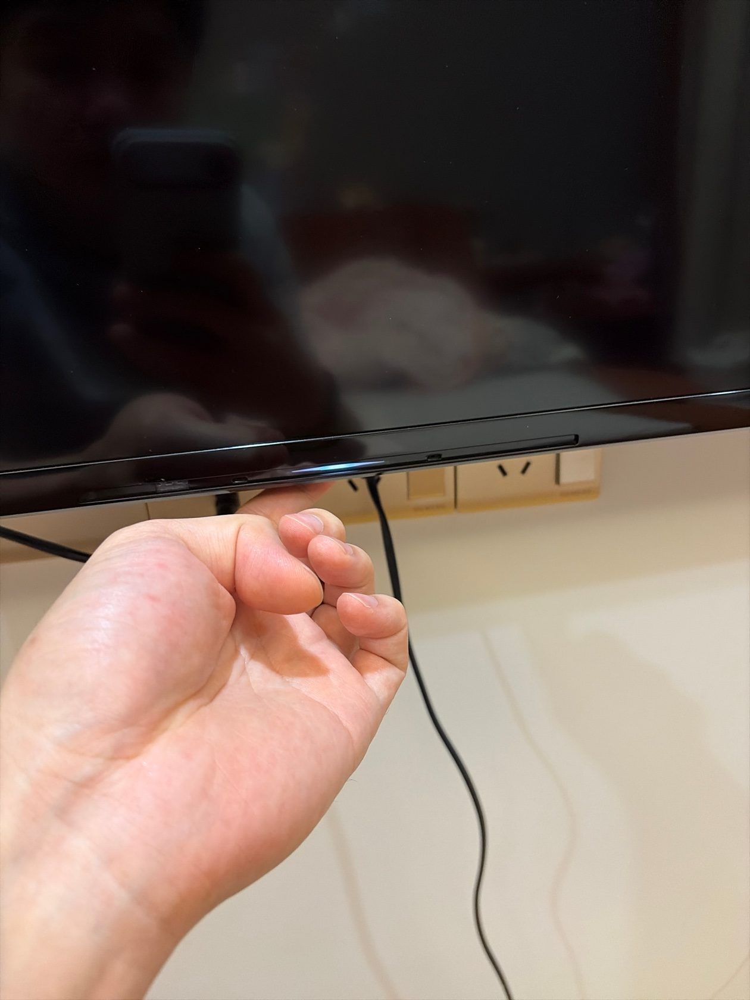
*關卡 6：拔電約兩小時後再試強制恢復，白色 LED 首次亮起，恢復真正觸發。*

### 關卡 7 — 完成驗證
- 主畫面為 Google TV，Netflix、YouTube、Disney+、Prime Video 等應用齊備，Google 帳戶可登入；之後可正常使用香港區應用（例如 myTV SUPER）。
- 「關於」中的 build 資訊：`BRAVIA_VH21_M_HK-user 12 STT2.230505.001.S158 682461 release-keys`——`M_HK` 與 `682461` 證明運行的是港版系統。
- 注意：「軟件版本」一欄顯示 `PKG6.8246.0977CNA`——版本號已更新至 6.8246.0977，但地區字尾仍是 CNA。該字尾來自出廠地區標記，不在 OTA 寫入的分區內，不會被刷寫改變；判斷成敗以 fingerprint 為準，不要被 CNA 字尾誤導。
- **收尾必做：到「設定 → 系統 → 關於 → 系統軟件更新」，關閉「自動檢查更新」。** 地區標記仍是 CNA，日後若收到國行 OTA 並安裝，可能覆蓋港版系統。任何系統更新提示都不要直接接受。

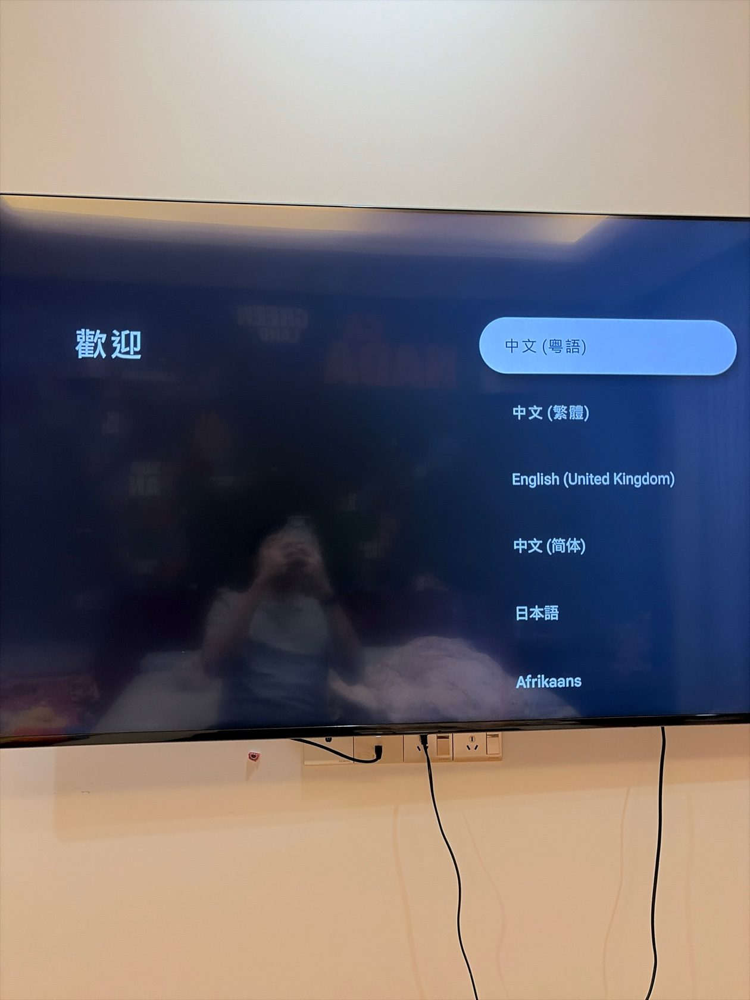
*關卡 7：恢復後首次開機，進入 Google TV 設定歡迎畫面，語言清單含中文（粵語）。*

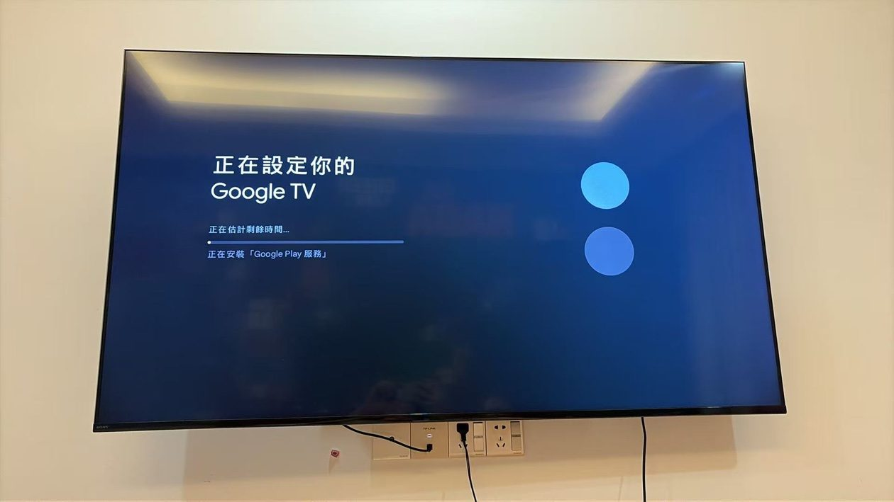
*關卡 7：設定流程的收尾階段（正在安裝 Google Play 服務）。*

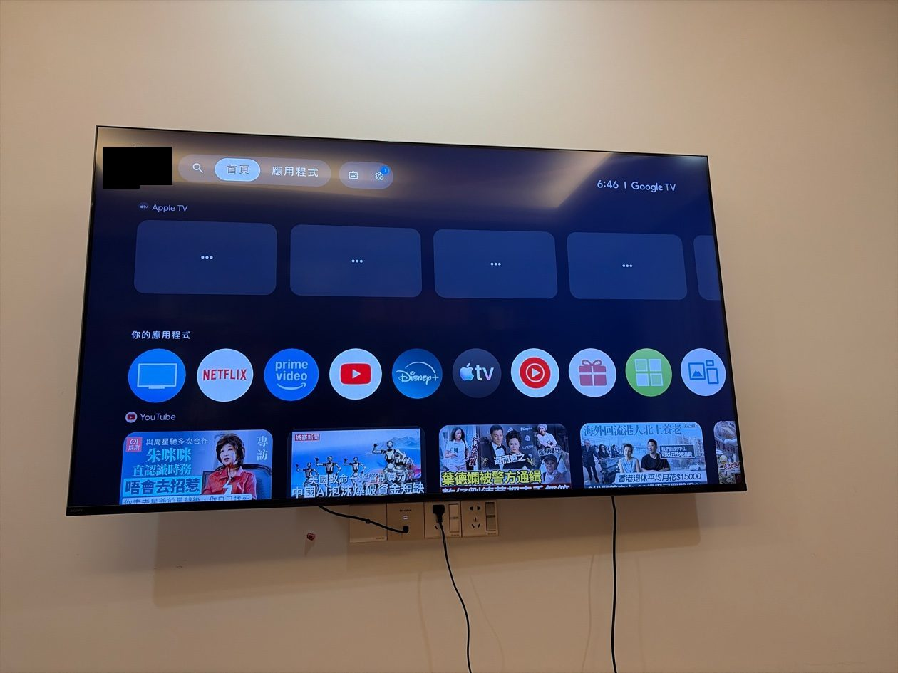
*關卡 7：設定完成，進入 Google TV 主畫面，香港區應用與內容齊備。*

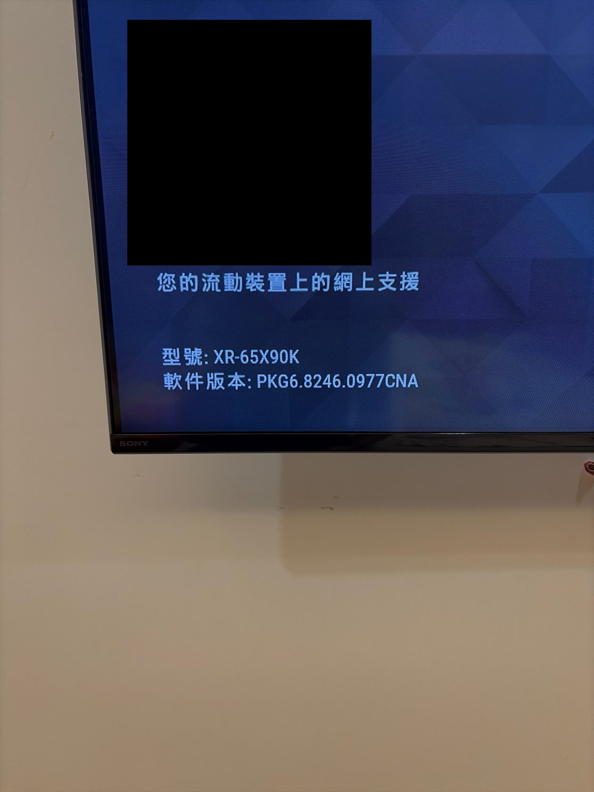
*關卡 7：版本號已是 6.8246.0977，但字尾仍為 CNA——字尾來自出廠地區標記，不代表刷寫失敗（支援 QR code 已打碼）。*

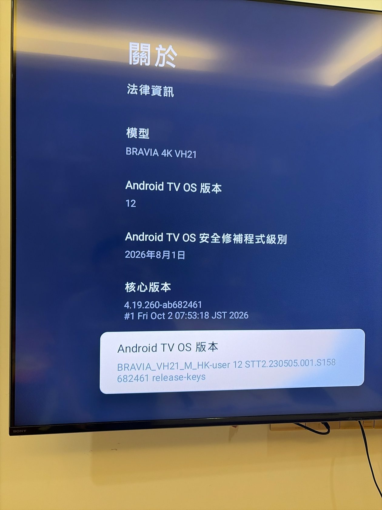
*關卡 7：build 資訊為 `BRAVIA_VH21_M_HK … 682461`，是運行港版系統的確證。*

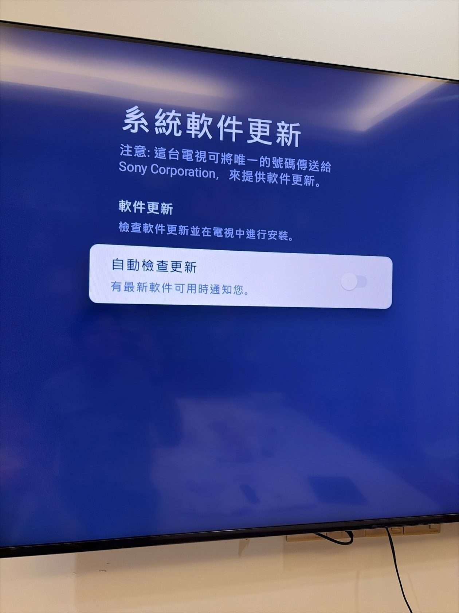
*關卡 7（收尾必做）：關閉「自動檢查更新」，避免日後國行 OTA 覆蓋港版系統。*

## 輔助腳本

```bash
chmod +x scripts/hk-flash.sh
TV_IP=<tv-address> scripts/hk-flash.sh \
  --local <file-on-this-computer> \
  --remote <absolute-path-on-tv>
```

腳本會先印出步驟，用本機 `sha256sum` 計算本地雜湊，再讀電視上同一路徑的 sha256。不一致就停止，不會送出 `START_UPDATE` 或 `SHOW_UPDATE_CONFIRMATION`。一致之後，要在終端機裡輸入 `START_UPDATE` 才會送出第一個動作；輸入 `SHOW_UPDATE_CONFIRMATION` 才會送出第二個。標準輸入不是終端機時，腳本拒絕送出這兩個動作。`DRY_RUN=1` 只印本地雜湊和將要執行的指令，不連電視。腳本自動化的是關卡 2 與關卡 4、5 的主要動作；關卡 0、1、3、6、7 請照上文人手核對。

## 關於 USB 路線

USB 更新不是本方法的備用路線：電視的 USB／設定內更新會校驗套件地區，港版套件在國行機上會被直接拒絕——這正是要改走 ADB 槽位寫入的原因。USB 路線只適用於同地區的官方更新。

## 本倉庫不放什麼

`.gitignore` 排除 `*.zip`、`*.dep` 和 `firmware/`。Sony 韌體留在本機，不提交進這個倉庫。本倉庫亦不記錄區域網位址、MAC、帳戶或任何憑證；相片中的個人資料已打碼。
